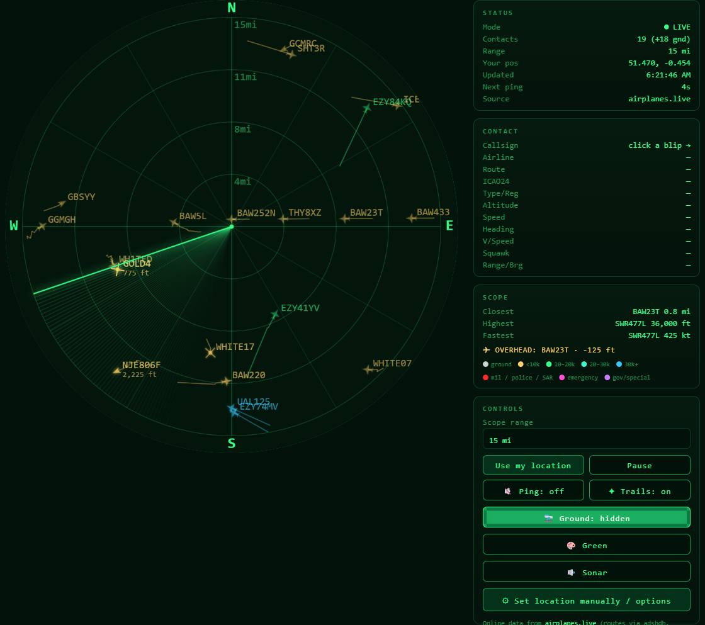

# R4D4RVU

**A classic round radar that sweeps the skies above you — from live community ADS-B data, a local SDR dongle, or an RTL-SDR / HackRF One plugged straight into your browser — plus a bonus in-browser HackRF receiver to listen to the pilots.**



R4D4RVU centers a vintage CRT-style radar scope on your location and plots every aircraft within range as a glowing blip — with a continuously rotating sweep, type-specific symbols, altitude colours, fading trails, a sonar ping, and a clickable contact readout that pulls airline, route, and a photo of the actual aircraft. It's a single self-contained `index.html`: no build step, no dependencies, no account.

> Inspired by [AnthonySturdy/micro-radar](https://github.com/AnthonySturdy/micro-radar).

**▶ Live demo:** https://raddad87.github.io/R4D4RVU/

---

## ✈️ Features

- **Authentic radar scope** — circular display, range rings, compass spokes, N/E/S/W cardinals, and a sweeping hand with a phosphor-style fading trail.
- **Your location, your sky** — uses the browser Geolocation API to center on you, or set coordinates manually.
- **Self-healing online feed** — the radar probes several community ADS-B networks ([adsb.lol](https://adsb.lol), [adsb.fi](https://adsb.fi), [adsb.one](https://adsb.one), public relays, or your own proxy) and keeps whichever one your browser can actually reach, so one provider going away no longer takes the scope down.
- **Three data sources** — the online community feed above, a **local SDR** feed (`dump1090-fa`/`readsb`) for fully offline use, or an **RTL-SDR or HackRF One plugged straight into the browser** over WebUSB.
- **Type-specific symbols** — winged jets, light triangles, helicopter rotors, drone diamonds, glider darts, and ground squares (from the ADS-B emitter category).
- **Altitude colours** — blips coloured by band (ground · <10k · 10–20k · 20–30k · 30k+) with a legend.
- **Threat & responder highlighting** — emergency squawks (7500/7600/7700) flash **pink**; **military, police, coast guard, fire, and medical** aircraft are **bright red** with a ring; **government / customs / border** are **purple**. Classification uses the ADS-B military flag plus the registered operator (via adsbdb) and an anchored-callsign pass.
- **Smooth motion & fading trails** — aircraft are dead-reckoned between updates so they glide and leave a continuous trail that holds to 25 miles, then fades out by 32.
- **Rich contact on click** — callsign, airline, origin → destination, ICAO24, type & registration, altitude, speed, heading, vertical speed, squawk, range/bearing, and a **photo** of the aircraft (planespotters).
- **Scope HUD** — live closest / highest / fastest, plus an "overhead" alert when a plane passes within 1.5 mi.
- **Sonar ping** — a classic submarine ping as the sweep crosses each contact, with selectable voices (Sonar / Sub / Blip / Soft).
- **Themes** — recolour the whole scope: Green, Amber, Ice, or Alert.
- **Shareable flight links** — copy a link that re-opens the radar locked onto the selected aircraft.
- **Track, hide-ground, range** — lock onto a plane (homing line + ring), hide parked traffic, and pick 15–300 mi.
- **Works on mobile** — responsive layout, finger-sized taps, the circle sized to your screen.
- **🎧 Airband listener (experimental)** — a companion page (`airband.html`) tunes your **HackRF One** to VHF airband and plays live **ATC voice** in the browser (AM demodulated in JS), preloaded with DCA / IAD / BWI tower, ground, clearance, approach &amp; departure frequencies.

---

## 🚀 Quick start

Open **https://raddad87.github.io/R4D4RVU/**, click **Use my location**, and allow the prompt. That's the whole setup.

Run it yourself:

```bash
python3 -m http.server 8000   # from the folder with index.html, then visit http://localhost:8000
```

### Deploy to GitHub Pages
The app is a single `index.html` at the repo root: **Settings → Pages → Deploy from a branch → `main` → `/ (root)`**.

---

## 🛰️ Data sources & going offline

Open **⚙ Set location manually / options → Data source**:

| Source | What it does |
| --- | --- |
| **Online — community ADS-B** | Default. Free community ADS-B over the internet, no key. Auto-selects the first reachable feed (adsb.lol → adsb.fi → adsb.one → public relays), or your own proxy if you set one. |
| **Local SDR (offline)** | Reads a local `dump1090-fa`/`readsb` `aircraft.json` — fully offline. |
| **RTL-SDR (USB) — in browser** | Decodes a plugged-in RTL-SDR **in the browser** over WebUSB (Chrome/Edge desktop, experimental). |
| **HackRF One (USB) — in browser** | Tunes & decodes a plugged-in **HackRF One in the browser** over WebUSB (Chrome/Edge desktop). **Experimental & unverified** — may need gain tuning; if no contacts appear, use Local SDR mode instead. |

### Why the feed list exists

R4D4RVU originally targeted the OpenSky Network, but OpenSky's data endpoint only sends CORS headers for its own site, so no static page can read it. airplanes.live did allow direct browser requests, which is why it used to be the default — until **airplanes.live closed its free public API**: `api.airplanes.live/v2/...` now returns

```
HTTP 403  {"error": "Please contact us at contact@airplanes.live..."}
```

for anyone who isn't a feeder or key holder. A single hard-coded endpoint is a single point of failure, so the radar now keeps a list and uses the first feed that answers *from your browser*:

1. **Your own proxy**, if you set one — the only reliable option (see below)
2. `api.adsb.lol` · `opendata.adsb.fi` · `api.adsb.one` — direct
3. `api.airplanes.live` — only if you paste an API key in ⚙ options
4. Public CORS relays in front of adsb.lol / adsb.fi — last resort, shared rate limits

The active feed is shown as **Source** in the STATUS panel. If every source fails, the scope now says so (`ERR · No feed`) instead of going quiet.

### Give yourself a private feed (recommended)

The community feeds don't all send `Access-Control-Allow-Origin`, and the public CORS relays are throttled or gone, so a proxy you control is the only reliable path.

**A Cloudflare Worker cannot do this job.** That was the obvious approach and it was tried — measured from a deployed Worker, not guessed:

```
api.adsb.lol         429   rate-limited (Workers egress from a shared, saturated IP pool)
opendata.adsb.fi     403   sits behind Cloudflare; Worker-to-Cloudflare is refused
api.adsb.one         403   same
opensky-network.org  522   same
```

The identical requests from an ordinary machine all return 200. The host was wrong, not the code, so the Worker version has been removed rather than left around to mislead.

**What works: [`local-feed-proxy.js`](local-feed-proxy.js)** — a dependency-free Node server that runs on your own machine, so the outbound request carries your own IP:

```bash
node local-feed-proxy.js       # listens on http://127.0.0.1:8787
```

If you serve the radar locally, point **⚙ options → My CORS proxy** straight at `http://127.0.0.1:8787`. To use it with the hosted GitHub Pages build, an https page cannot read http://localhost (mixed content), so put a tunnel in front:

```bash
cloudflared tunnel --url http://127.0.0.1:8787    # free, no account, prints a *.trycloudflare.com URL
```

Paste that URL into **⚙ options → My CORS proxy**. ### Let the proxy publish its own address

A quick tunnel's hostname changes on every restart, which normally means re-pasting it into ⚙ options. Instead, have the proxy write its current address to **`feed-url.json`** next to `index.html`:

```json
{ "url": "https://something-random.trycloudflare.com" }
```

The radar fetches that file on load (same origin, so no CORS involved) and uses it as the proxy whenever you haven't set one by hand. Leave **My CORS proxy** blank and the rotating hostname stops mattering — publish the new value on each start and the scope follows it.

Because that file is public, the address in it is public too. Give the proxy a **shared token** so the address alone is useless: drop a random string in `key.txt` next to `local-feed-proxy.js` (or set `RADAR_FEED_KEY`), and every request then has to be

```
https://<tunnel-host>/<token>/v2/point/<lat>/<lon>/<radius_nm>
```

Anything without the right token gets a bare `404` — no CORS header, no hint that a service is there. Put the token in **⚙ options → My proxy key**; the radar inserts it as the first path segment. The token is stable and lives only in your browser, while the rotating hostname is the part that gets published, so the two halves are never public together.

For a fixed address instead, use a named tunnel on a domain you own:

```bash
cloudflared tunnel login                                   # one click in the browser
cloudflared tunnel create radar-feed
cloudflared tunnel route dns radar-feed radar.example.com  # adds the CNAME for you
```

Then put this in `~/.cloudflared/config.yml` and run `cloudflared tunnel run radar-feed`:

```yaml
tunnel: <tunnel-id>
credentials-file: <path printed by "tunnel create">
ingress:
  - hostname: radar.example.com
    service: http://127.0.0.1:8787
  - service: http_status:404
```

Start the proxy and the tunnel together at logon (a Task Scheduler task on Windows, a launchd/systemd unit elsewhere) so it comes back after a reboot.

The proxy tries adsb.lol → adsb.fi → adsb.one, normalises both response shapes, caches for 5 s, and answers with `Access-Control-Allow-Origin: *`.
**Turn your dongle into a radar in one command** — the repo ships a Docker stack (readsb + a same-origin web server) and double-click launchers:

```bash
cp .env.example .env     # set your receiver LAT / LON
docker compose up -d     # or double-click start-radar.command / .bat / .sh
# open http://localhost:8078/
```

Thorough step-by-step instructions for every path — RTL-SDR (in-browser / Docker / existing decoder), **HackRF One** & PortaPack, antenna tips, driver setup (Zadig / `modprobe`), and troubleshooting — are in **[SDR-SETUP.md](SDR-SETUP.md)**. Local SDR mode works with **any** decoder that outputs `aircraft.json` — RTL-SDR, **HackRF One** (e.g. dump1090_sdrplus or readsb+SoapyHackRF), Airspy, SDRplay, and more. A PortaPack **H4M** running Mayhem decodes on-device; to feed the radar, connect its HackRF to a computer and run a host decoder.

### Run it fully offline / from an SSD

The in-browser decoder's libraries are **vendored in the repo** (`rtlsdr.bundle.js`, `mode-s-demodulator.bundle.js`) — so both the **RTL-SDR** and the experimental **HackRF One** WebUSB paths decode your device with **no internet**. Copy the folder to a USB stick or SSD, double-click **`serve-offline.command` / `.bat` / `.sh`** (it serves over `http://localhost` — which WebUSB requires — using Python or Node), plug in the dongle, and pick **RTL-SDR (USB)** or **Local SDR**. Everything on the scope works offline; only the airline/route/photo lookups need a connection. See **Path F** in [SDR-SETUP.md](SDR-SETUP.md).

---

## 🎧 Listen to ATC voice (airband)

Want to hear the pilots and controllers, not just watch the blips? The repo ships an experimental **in-browser HackRF airband receiver** — **[airband.html](airband.html)** ([live](https://raddad87.github.io/R4D4RVU/airband.html)), also linked from the radar's ⚙ options.

It tunes your **HackRF One** to a VHF airband channel (118–137 MHz, with a 250 kHz digital IF to dodge the DC spur), mixes it to baseband, low-pass-decimates 2 MS/s down to 10 kHz audio, **AM-demodulates** it, and plays it through your speakers — all over WebUSB, **nothing installed**. Squelch, volume, a signal meter, ± fine-tuning, and manual frequency entry are built in. It comes preloaded with **DCA, IAD, and BWI** tower / ground / clearance / approach / departure / ATIS frequencies.

> Desktop Chrome/Edge only · listens to **one frequency at a time** · the HackRF can only be claimed by one page at a time, so **stop the radar's HackRF feed before starting the airband listener**. It's **experimental** (CPU-heavy JS AM demod, basic adjacent-channel rejection). Listening to ATC is legal in the US; transmitting is not.

## 🎛️ Controls

| Control | What it does |
| --- | --- |
| **Scope range** | Radar radius, 15–300 miles. |
| **Use my location** | Re-centers the scope on your GPS/geolocation. |
| **Pause / Resume** | Freezes the sweep and polling. |
| **Ping** | Sonar beep as the sweep passes a contact. Tap the sound name to change voice. |
| **Trails** | Toggle the fading position trails. |
| **Ground** | Show or hide aircraft on the ground (hidden by default). |
| **Theme** | Cycle Green → Amber → Ice → Alert. |
| **Track this aircraft** | Lock onto the selected plane — homing line, pulsing ring, pinned details. |
| **Share** | Copy a link that re-opens the radar tracking that flight. |
| **Click a blip** | Opens the Contact readout (airline, route, photo, and more). |

---

## 🧭 How it works

- **Distance** uses the haversine formula on the WGS-84 sphere; **bearing** uses the great-circle initial-bearing formula (0° = North, clockwise). Everything is shown in **miles**.
- A blip sits at `distance / range` of the scope radius, rotated to its bearing — north is up.
- Between data refreshes each airborne plane is **dead-reckoned** from its speed and heading, then corrected on the next update — so motion is smooth and trails are continuous.
- Brightness tracks how recently the sweep passed each blip's bearing, mimicking a phosphor tube.
- Altitude in feet, speed in knots, vertical rate in feet/min come straight from the ADS-B feed.

## 🛠️ Configuration

Near the top of the `<script>` in `index.html`:

```js
const CFG = {
  refreshMs: 12000,      // online refresh interval
  sweepPeriodMs: 4000,   // one sweep revolution
  trailFade: 25,         // miles before a trail starts fading
  trailMax: 32,          // miles where it disappears
};
```

---

## 📦 Project structure

```
R4D4RVU/
├── index.html                  # the entire app (HTML + CSS + JS)
├── rtlsdr-webusb.js            # in-browser WebUSB decoder (RTL-SDR + experimental HackRF)
├── airband.html                # experimental in-browser HackRF airband (ATC voice) listener
├── rtlsdr.bundle.js            # vendored RTL-SDR driver (offline, no CDN)
├── mode-s-demodulator.bundle.js# vendored ADS-B demodulator (offline)
├── docker-compose.yml          # one-command readsb + radar stack
├── nginx.conf                  # serves the app + same-origin feed proxy
├── .env.example                # receiver location / tuner settings
├── start-radar.command/.sh/.bat# double-click launchers (Docker stack)
├── serve-offline.command/.sh/.bat # local static server for offline/SSD use
├── install-on-dump1090fa.sh    # installer for existing decoders
├── SDR-SETUP.md                # full SDR + offline setup guide
├── screenshot-radar.jpg        # screenshot
├── README.md                   # this file
└── LICENSE                     # MIT
```

---

## ⚖️ Disclaimer

Positions are approximate, can be delayed, and depend on community ADS-B coverage. **R4D4RVU is for hobby and educational use only — never for navigation or any safety-critical purpose.**

## 🙏 Credits

Live data © the community ADS-B networks ([adsb.lol](https://adsb.lol), [adsb.fi](https://adsb.fi), [adsb.one](https://adsb.one)) and their contributors · routes/owners via [adsbdb](https://www.adsbdb.com) · photos via [planespotters.net](https://www.planespotters.net) · in-browser SDR uses [rtlsdrjs](https://github.com/sandeepmistry/rtlsdrjs) (Apache-2.0) and [mode-s-demodulator](https://github.com/watson/mode-s-demodulator) (MIT); the experimental HackRF WebUSB paths follow the [libhackrf](https://github.com/greatscottgadgets/hackrf) / [hackrf.js](https://github.com/mildsunrise/hackrf.js) (MIT) protocol; airband frequencies via [OurAirports](https://ourairports.com).

## 📄 License

[MIT](LICENSE) — do what you like, no warranty.
